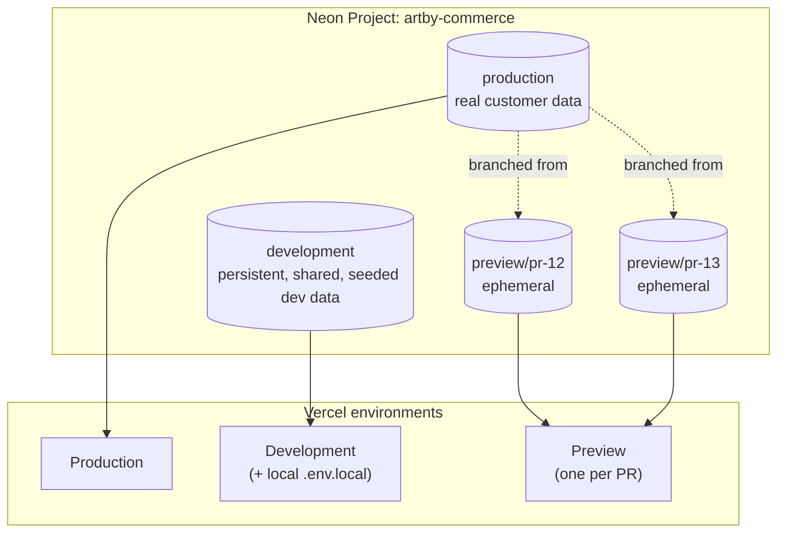
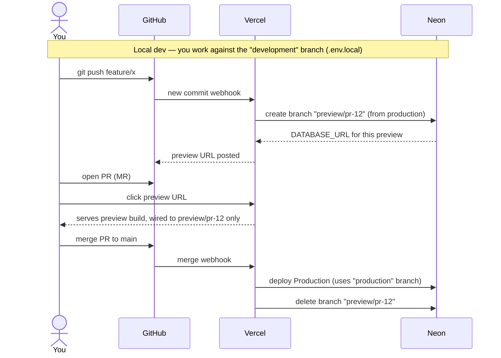

# Neon + Vercel branching strategy

How database branches map to environments, and what happens to data isolation
as code moves from a local feature branch through a PR/preview to `main`.

## 1. Branch topology

Three tiers, three purposes: `production` is sacred, `development` is the
everyday shared sandbox, and `preview/*` branches are throwaway and scoped to
a single PR's lifetime.

## 2. Lifecycle: dev → PR → preview → merge

Key points:

- Every PR gets its own isolated copy of the data (schema + snapshot), so a
  reviewer testing destructive changes on a preview can't corrupt prod or the
  shared dev branch.
- The preview branch is deleted automatically the moment Vercel tears down
  that preview deployment (PR closed or merged) — no manual cleanup, no
  orphaned branches piling up in the Neon dashboard.
- Production is only ever touched by the Production deployment, never by a
  preview build.

## 3. Migrations

`pnpm build` runs `pnpm db:migrate` before `next build`. Preview builds
therefore migrate their own `preview/pr-*` branch, and a production deploy
migrates the production branch. The migration connects to the same database
as `DATABASE_URL`. A `DIRECT_URL` for a different host is ignored, and the
pooled host has `-pooler` removed so the migration does not go through the
pooler.

A failed migration fails the deploy. GitHub CI still provisions its own
ephemeral branch and migrates it before `pnpm build`; the second migrate is
a no-op.

## 4. How the existing test harness fits in

Unrelated to all of the above — `test/setup/global-setup.ts`'s ephemeral
branch-per-test-run is a separate, third lifecycle purely for `pnpm test`
(local or CI), independent of Vercel previews. Nothing needs to change there.
